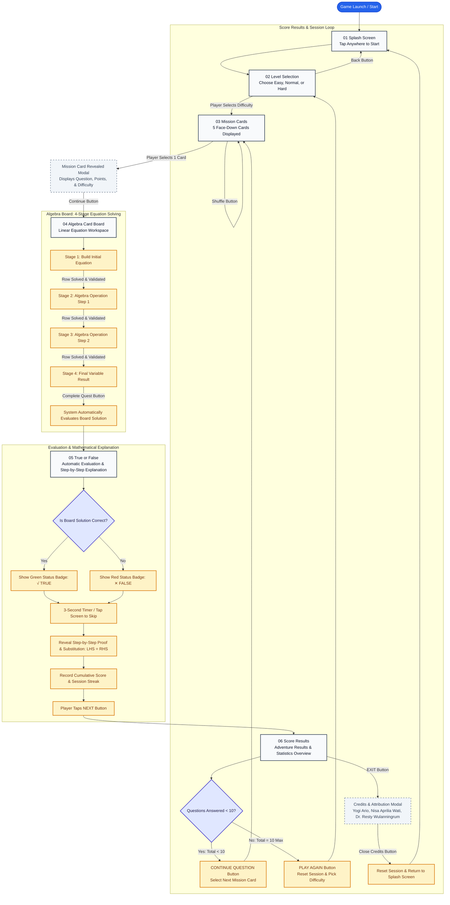

# Game Description & System Architecture — AlgeCard Adventure

> **Project Name:** AlgeCard Adventure  
> **Target Platform:** Android Mobile (Portrait Orientation)  
> **Engine:** Unity 6000.6.6f1 Universal 2D (URP)  
> **Language:** C# (.NET Standard 2.1)  
> **UI Language:** English (Player-facing)  
> **Architecture:** 100% Single-Player Offline (Zero Cloud/Server Dependency)  
> **Project Owner & Software Developer:** Yogi Ario  
> **Game Planner & Mathematics Expert:** Nisa Aprilia Wati  
> **Academic Advisor:** Dr. Resty Wulanningrum, M.Kom.  
> **Academic Institution:** Universitas Nusantara PGRI Kediri  

---

## 1. Executive Summary & Educational Mission

**AlgeCard Adventure** is a mobile mathematics educational game tailored for junior high school students to master linear equations through step-by-step tactile card mechanics. Set in a colorful cartoon fantasy universe with ancient wooden plaques, weathered parchment scrolls, and insect explorer companions (Professor Bug and companion mascots), the game transforms abstract algebraic manipulations into intuitive, tangible card-arranging puzzles.

### Key Gameplay Pillars
1. **Zero-Guessing Step-by-Step Problem Solving:** Unlike conventional multiple-choice quiz games, players physically construct equations, manipulate mathematical operations, and isolate variables through 4 structured algebra stages.
2. **Tactile Deck of Cards:** A complete sidebar deck containing numbers (0–9), algebraic variables (`x`, `y`, `a`, `b`), and mathematical operators (`+`, `-`, `×`, `÷`, `=`), coupled with a 3D Clear tool and a directional compass NavPad.
3. **Automatic Assessment & Mathematical Proof:** After solving the board, the system automatically evaluates the answer and presents a visual status badge (√ TRUE or ✕ FALSE) with a 3-second feedback timer, followed by rigorous mathematical substitution proofs demonstrating left-hand side (LHS) vs. right-hand side (RHS) equivalence.
4. **Structured 10-Question Sessions:** Each adventure session tracks cumulative accuracy across up to 10 missions, offering tiered motivational feedback and comprehensive performance statistics.

---

## 2. Core Game Loop Architecture

The player experiences an interconnected 6-screen journey:

```text
[01 Splash Screen] ➔ [02 Level Selection] ➔ [03 Mission Cards] ➔ [04 Algebra Board] ➔ [05 True / False] ➔ [06 Score Results]
         ▲                                                                                                    │
         │                                       ◀── CONTINUE QUESTION (Questions < 10) ──────────────────────┤
         │                                                                                                    │
         └── EXIT / RESET SESSION ◀───────────── Credits Modal ◀──────────────────────────────────────────────┘
```

### Detailed Screen Progression

### Screen 01: Splash Screen
- **Visuals:** Fantasy landscape background (`splash_bg.png`) featuring a magical floating castle, official adventure logo, and pulsing call-to-action text.
- **Interactions:** Tap anywhere on the screen to initialize audio playback and seamlessly navigate to Level Selection.

### Screen 02: Level Selection
- **Visuals:** Central carved wooden board displaying three distinct difficulty cards with star laurels:
  - **Easy:** 1 Star (`★`), single-step linear equations.
  - **Normal:** 2 Stars (`★★`), multi-step equations with additive and multiplicative terms.
  - **Hard:** 3 Stars (`★★★`), advanced equations with fractional division and negative integers.
- **Interactions:** Tap any level card to initialize a fresh session and draw randomized questions; tap "◀ BACK" to return to Splash Screen.

### Screen 03: Mission Cards (The Quest Hub)
- **Visuals:** 5 face-down fantasy playing cards resting on a wooden explorer desk with gold leaf trimming, accompanied by background music (*Cozy Fantasy BGM*).
- **Interactions:** 
  - **Shuffle Button:** Reshuffles the eligible mission pool.
  - **Card Selection:** Tapping any card triggers a 3D flip animation, opening the **Mission Details Modal** that showcases the equation prompt, difficulty rating, and potential mission points.
  - **Continue Button:** Transitions into the Algebra Card Board.

### Screen 04: Algebra Card Board (Interactive Workspace)
- **Visuals:** Dual-column mobile workspace:
  - **Left Area (Scrollable Board):** Mission plaque with Professor Bug avatar, equation statement, and 4 sequential algebra stage rows with dynamic status badges (`LOCKED`, `ACTIVE`, `DONE ✓`) and 3D wooden directional arrows.
  - **Right Area (Fixed Deck of Cards):**
    - Numbers Section: 0 through 9 number cards.
    - Variables Section: `x`, `y`, `a`, `b` variable cards.
    - Operators Section: `+`, `-`, `×`, `÷`, and `=` operator cards.
    - 3D Gold CLEAR Button: Instantly resets placed cards on the active row.
    - Adventure Compass NavPad: 5-way directional pan and view-reset controller.
  - **Bottom Action Footer:** "MORE DETAILS" button for reviewing previous stages and gold "COMPLETE QUEST" / "CONTINUE" button to advance.
- **Mechanics:** Tap-to-Slot places cards into target equation slots; Tap-to-Clear removes placed cards back to the deck. Completing Stage 4 automatically transitions to Screen 05 with the solution status recorded.

### Screen 05: True or False & Explanation
- **Visuals:** Clean status display with immediate feedback:
  - Top status ribbon indicating √ TRUE (Green) or ✕ FALSE (Red).
  - 3-second animated countdown timer bar with an optional tap-to-skip button.
  - **Explanation Parchment:** Automatically reveals substitution proof step-by-step (`LHS = RHS`).
  - **Action Button:** Prominent gold **"NEXT ❯"** button.
- **Interactions:** Tapping **"NEXT ❯"** transitions directly to Screen 06 (Score Results) to review session progress and cumulative statistics.

### Screen 06: Score Results & Session Summary
- **Visuals:** Sunlit sky castle background, 3D laurel wreath score ribbon, and three performance cards:
  - **Correct Answers:** Number of correctly solved equations with green checkmark badge.
  - **Wrong Answers:** Number of incorrect submissions with red cross badge.
  - **Time Spent:** Total session duration formatted in `MM:SS`.
- **Tiered Feedback:**
  - `Score >= 80%`: "Very good! Outstanding mathematical mastery!"
  - `60% <= Score < 80%`: "Good job! Keep practicing to reach perfection!"
  - `Score < 60%`: "Nice effort! Every challenge makes you stronger!"
- **Interactions:**
  - **CONTINUE QUESTION:** Available when fewer than 10 questions have been answered. Returns player to Screen 03 to choose their next mission card.
  - **PLAY AGAIN:** Appears when the 10-question session cap is reached. Resets session counters and returns to Screen 02 (Level Selection).
  - **EXIT:** Opens the official **Credits & Attribution Modal** honoring the development team and academic advisory board. Closing the modal resets session state and returns to Screen 01.

---

## 3. Official Game Flowchart (Mermaid)



---

## 4. Mathematical Engine & Scoring Specifications

### 1. Linear Equation Tokenizer (`TokenizeExpression`)
The algebraic parser breaks equation strings down into distinct card tokens:
- **Example 1:** `"3x + 5 = 20"` ➔ `["3", "x", "+", "5", "=", "20"]`
- **Example 2:** `"y - 3 = 5"` ➔ `["y", "-", "3", "=", "5"]`
- **Example 3:** `"2a = 14"` ➔ `["2", "a", "=", "14"]`

### 2. Four-Stage Stage Progression
- **Stage 1 (Initial Equation):** Player arranges the exact mathematical problem statement.
- **Stage 2 (Step 1 Operation):** Player performs the first isolation step (e.g. subtracting constants from both sides: `3x = 20 - 5`).
- **Stage 3 (Step 2 Arithmetic):** Player evaluates the intermediate arithmetic (e.g. `3x = 15`).
- **Stage 4 (Final Variable Result):** Player resolves the single variable value (e.g. `x = 5`).

### 3. Scoring Formula (DEC-09)
$$\text{Score} = \text{Round}\left(\frac{\text{Correct Answers}}{\text{Total Answered}} \times 100\right)$$
- Every question attempted counts toward the denominator.
- Streak bonuses and cumulative point multipliers are computed dynamically per session.

---

## 5. Development Credits & Academic Attribution

- **Lead Software Developer:** Yogi Ario  
- **Game Planner & Mathematics Expert:** Nisa Aprilia Wati  
- **Academic Advisor:** Dr. Resty Wulanningrum, M.Kom.  
- **Academic Institution:** Universitas Nusantara PGRI Kediri  
- **Governance Framework:** Google Antigravity IDE 8-Pillar AI Governance Protocol  
