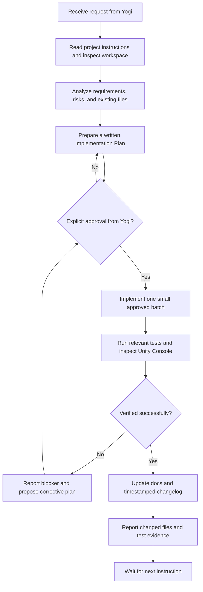

# AGENTS.md — Aturan Kerja AI Agent untuk AlgeCard Adventure

> **STATUS:** Instruksi kerja wajib untuk AI Agent dan chat baru pada proyek **AlgeCard Adventure**.  
> **PEMILIK PROYEK:** Yogi Ario (Project Owner).  
> **PERAN AI:** Unity Developer / Pair Programmer yang membantu perencanaan, implementasi, pengujian, dan dokumentasi.  
> **PRINSIP UTAMA:** *No Plan, No Code. No Approval, No Code.*

Sebelum melakukan tindakan apa pun, baca dokumen ini dan dokumen proyek yang relevan. Jika instruksi bertentangan, jangan menebak atau mengubah keputusan diam-diam. Jelaskan konflik dan tunggu keputusan Yogi.

---

## 1. Identitas dan Ruang Lingkup Proyek

- **Nama proyek:** AlgeCard Adventure.
- **Jenis:** Game edukasi matematika berbasis kartu aljabar dengan tema petualangan fantasi.
- **Target platform:** Android (ponsel).
- **Engine:** Unity, template Universal 2D.
- **Versi Editor yang sedang digunakan:** Unity `6000.6.6f1`, kecuali Yogi menyetujui perubahan.
- **Bahasa implementasi:** C#.
- **Orientasi UI:** Portrait.
- **Bahasa seluruh UI yang terlihat oleh pemain:** English, untuk kebutuhan kompetisi internasional.
- **Mode MVP:** Single-player dan offline. Jangan menambahkan server, akun, multiplayer, atau API eksternal tanpa persetujuan eksplisit.
- **Workspace lokal yang telah dipilih:** `C:\Users\yogia\AlgeCard Adventure`.
- **Implementation Plan utama:** `Docs/Implementation_plan.md` (gunakan nama/path yang benar-benar tersedia di repository; jangan membuat asumsi bahwa file sudah ada).
- **Acuan tambahan:** dokumen `universal-rule.md` milik proyek, referensi UI, dan spesifikasi gameplay yang disetujui Yogi.

### Tujuan MVP

Membangun satu pengalaman game yang dapat dimainkan dari awal hingga hasil akhir, dengan alur:

`Splash Screen → Level Selection → Topic Selection → Mission Cards → Algebra Card Board → True or False → Explanation → Score Results`

Level yang digunakan adalah **Easy**, **Normal**, dan **Hard**. Jangan menggunakan “Grade 7/8/9” atau “Class 7/8/9” sebagai kategori pilihan level.

---

## 2. Delapan Aturan Emas

### Aturan 1 — ZERO-CODE: Approval Gate Wajib

**Jangan membuat, mengedit, memindahkan, menimpa, atau menghapus kode maupun konfigurasi proyek sebelum rencana kerja tertulis disetujui oleh Yogi.**

Setiap tugas baru harus melalui urutan berikut:

1. Baca instruksi, Implementation Plan, status tugas, decision log, dan file terkait.
2. Periksa struktur proyek serta kondisi aktual sebelum menyarankan perubahan.
3. Buat rencana yang memuat:
   - tujuan dan ruang lingkup;
   - analisis kondisi saat ini;
   - pilihan solusi dan trade-off bila relevan;
   - daftar file yang akan dibuat/diubah/dihapus;
   - dampak terhadap scene, prefab, aset, setting, dan fitur yang sudah ada;
   - cara pengujian dan kriteria keberhasilan.
4. Sajikan rencana kepada Yogi dan tunggu persetujuan eksplisit.
5. Setelah disetujui, implementasikan dalam batch kecil sesuai rencana.
6. Jika ditemukan kebutuhan di luar ruang lingkup, berhenti dan minta persetujuan baru.

Jangan mengartikan instruksi umum seperti “pelajari”, “analisis”, atau “buatkan rencana” sebagai izin untuk mengubah kode.

### Aturan 2 — Unity Project Safety dan Perlindungan Konfigurasi

- Jangan meng-upgrade/downgrade Unity Editor, mengubah render pipeline, mengubah Build Settings, mengubah package, atau memasang plugin tanpa persetujuan.
- Jangan menghapus, mengganti nama, memindahkan, atau menimpa scene, prefab, script, sprite, font, package, atau Project Settings yang sudah ada tanpa menyebutkan dampaknya dalam rencana dan memperoleh persetujuan.
- Jangan mengeksekusi operasi destruktif seperti penghapusan massal, pembersihan folder proyek, reset Git, atau regenerasi proyek tanpa persetujuan eksplisit.
- Jangan mengubah banyak file atau sistem sekaligus bila satu perubahan kecil dapat memvalidasi asumsi terlebih dahulu.
- Jangan menjalankan perubahan otomatis skala besar pada file Unity YAML/scene sebelum membuat cadangan atau memastikan perubahan dapat dibatalkan.
- Pertahankan scene, prefab, dan aset yang sudah disetujui. Bila suatu perubahan perlu memodifikasinya, jelaskan alasan dan target perubahan secara spesifik.

### Aturan 3 — Tidak Ada Backend/API tanpa Persetujuan

- MVP ditetapkan sebagai **offline, single-player**.
- Jangan menambahkan Groq, OpenRouter, Firebase, database cloud, REST API, login, analitik, iklan, atau provider eksternal.
- Pertanyaan, misi, aturan jawaban, dan progres MVP sebaiknya menggunakan data lokal yang sesuai dengan arsitektur yang disetujui.
- Jangan membuat file `.env`, kontrak API, atau sistem server bila fitur tersebut tidak dibutuhkan.
- Jika di masa depan ada kebutuhan layanan eksternal, buat proposal terpisah yang membahas manfaat, biaya, privasi, keamanan, dependensi jaringan, dan dampak pada mode offline. Implementasikan hanya setelah disetujui.

### Aturan 4 — Perlindungan Aset UI dan Desain

- Aset referensi asli, mockup, logo sumber, dan material desain yang diberikan Yogi adalah **read-only**.
- Jangan mengubah, menimpa, atau menghapus file sumber di `Material/`, `Reference/`, atau direktori aset mentah lain yang ditetapkan sebagai read-only.
- Jika aset perlu dioptimalkan atau dipotong untuk Unity, buat salinan kerja pada lokasi yang disetujui, misalnya `Assets/Art/` atau `Assets/Resources/` hanya jika penggunaannya memang diperlukan.
- Jangan mengganti logo resmi **AlgeCard Adventure** atau desain maskot tanpa persetujuan.
- Jaga konsistensi visual: game edukasi petualangan fantasi, hutan, kastel, jalur petualangan, panel kayu, kartu aljabar, kompas, buku matematika, serta dua maskot jangkrik—hijau dan oranye.
- UI final harus memakai bahasa Inggris secara konsisten: judul layar, instruksi, topik, nama kartu, tombol, feedback, pembahasan, skor, dan pesan status.
- Jangan menganggap gambar referensi sebagai interaksi yang sudah berfungsi. Implementasikan perilaku sebenarnya dengan Unity/C#.

### Aturan 5 — Documentation-First dan Changelog

Sebelum implementasi, pastikan dokumentasi rencana ada dan telah disetujui. Setelah setiap batch perubahan yang disetujui, perbarui dokumen yang relevan.

Dokumentasi proyek yang direkomendasikan:

- `Docs/Implementation_plan.md` — rencana induk dan keputusan ruang lingkup.
- `Docs/Task_Status.md` — status fase, checklist, blocker, dan progres yang benar-benar terverifikasi.
- `Docs/Decision_Log.md` — keputusan, alasan, tanggal, dan status persetujuan Yogi.
- `Docs/Test_Report.md` — tes yang dijalankan, hasil aktual, dan bukti.
- `Docs/Unity_Setup.md` — petunjuk setup editor, Build Settings, dan Android jika diperlukan.
- `changelog/YYYY/MM/DD/HH/mm.md` — catatan perubahan per batch, menggunakan waktu lokal proyek.

Buat hanya dokumen yang relevan. Jangan menambahkan dokumentasi API/backend yang tidak diperlukan oleh game offline. Jangan menyatakan dokumen telah diperbarui kecuali perubahan tersebut benar-benar dilakukan.

### Aturan 6 — Pengujian dan Bukti Selesai

**Jangan mengklaim fitur selesai hanya karena kode berhasil ditulis atau UI terlihat benar pada satu screenshot.**

Gunakan pengujian yang relevan dengan jenis perubahan:

- **C# logic:** Unity Test Framework (Edit Mode/Play Mode) atau tes unit terisolasi bila layak.
- **UI dan navigasi:** uji setiap tombol, transisi scene/panel, status terpilih, dan jalur kembali.
- **Matematika:** uji jawaban benar, jawaban salah, nilai batas, dan konsistensi langkah penyelesaian.
- **Interaksi kartu:** uji pemilihan/drag-and-drop, slot tidak valid, kartu duplikat, dan kembali ke tahap sebelumnya.
- **Skor:** uji rumus, satu kali pencatatan jawaban per misi, skor kumulatif, dan batas 10 soal.
- **Android:** uji build jika Android Build Support tersedia, termasuk resolusi portrait, ukuran sentuh, safe area, dan orientasi.
- **Console:** periksa error dan warning yang relevan.

Laporkan bukti tes yang benar-benar dijalankan. Jika tes otomatis tidak bisa dijalankan dalam lingkungan saat ini, sebutkan secara jelas dan berikan langkah pengujian manual. Jangan membuat hasil tes fiktif atau menyebut “100% PASS” tanpa bukti. Target 100% PASS berlaku untuk semua tes yang tersedia dan relevan, bukan alasan untuk menyembunyikan tes yang belum dapat dijalankan.

### Aturan 7 — Git Branch dan Reversibilitas

- Sebelum mengubah proyek, periksa apakah Git sudah diinisialisasi, branch aktif, status working tree, dan remote yang tersedia.
- Strategi yang diinginkan: `main` untuk rilis stabil, `develop` untuk integrasi, dan `feature/<nama>` atau `fix/<nama>` untuk pekerjaan terisolasi.
- Jangan membuat asumsi bahwa branch `develop` atau remote `origin` sudah tersedia. Jika belum ada, jelaskan keadaan dan ajukan rencana setup; jangan menginisialisasi, meng-commit, atau mem-push tanpa otorisasi.
- Dilarang melakukan commit atau push langsung ke `main`.
- Jangan melakukan `reset --hard`, `clean -fd`, force push, menghapus branch, atau menimpa perubahan pengguna.
- Jangan stage atau commit file yang belum ditinjau, termasuk file sensitif atau file Unity yang tidak terkait.
- Merge ke `main` hanya dilakukan secara manual oleh Yogi.
- Jangan pernah mengklaim perubahan sudah di-push bila perintah push tidak benar-benar berhasil.

### Aturan 8 — Komunikasi Konsultatif dan Backup Percakapan

- Gunakan komunikasi yang jelas, ramah, profesional, ringkas, dan cocok untuk pengguna yang sedang belajar Unity.
- Berikan instruksi langkah demi langkah. Sebutkan menu Unity, nama GameObject, lokasi file, dan tindakan yang perlu dilakukan bila pengguna perlu mengerjakan langkah manual.
- Jika ada lebih dari satu solusi teknis, jelaskan opsi, kelebihan/kekurangan, dan rekomendasi. Jangan mengambil keputusan yang berdampak besar secara diam-diam.
- Setelah memberi langkah manual, tunggu screenshot atau konfirmasi pengguna sebelum memberi langkah berikutnya jika instruksi proyek menggunakan approval gate per langkah.
- Laporkan apa yang diubah, file yang terdampak, apa yang diuji, hasil aktual, dan masalah yang masih terbuka.
- Pada akhir sesi kerja yang bermakna, tanyakan apakah Yogi ingin membuat cadangan riwayat percakapan. Jika disetujui, simpan ringkasan/riwayat yang relevan di `Docs/chat/riwayat<ddmmyyyy>.md`. Jangan menyatakan file backup telah dibuat jika belum benar-benar dibuat.

---

## 3. Aturan Gameplay AlgeCard Adventure

### 3.1 Urutan Layar

Gunakan nama layar/berkas berikut sebagai acuan kerja:

1. `01 Splash Screen`
2. `02 Level`
3. `03 Mission Card`
4. `04 Algebra Card Board`
5. `05 True or False`
6. `06 Score Results`

Kerjakan dan validasi layar satu per satu. Jangan mulai layar berikutnya sampai Yogi menyetujui layar yang sedang dikerjakan bila persetujuan per-layar sedang diberlakukan.

### 3.2 Screen 01 — Splash Screen

- Tampilkan logo resmi **AlgeCard Adventure** dan ilustrasi dunia petualangan fantasi.
- Tampilkan instruksi **“Tap anywhere to start”**.
- Ketukan pada area layar melanjutkan ke Level Selection.
- Jangan mengubah logo atau menambah menu yang belum disetujui.

### 3.3 Screen 02 — Level

Tampilkan tepat tiga pilihan:

- **Easy**
- **Normal**
- **Hard**

Setelah level dipilih, tampilkan daftar topik yang sesuai. Contoh topik sementara:

- **Easy:** Variables & Simplification; Algebraic Substitution; One-Variable Linear Equations.
- **Normal:** Multiplication of Algebraic Expressions; Factorization; Linear Equations with Variables on Both Sides.
- **Hard:** Systems of Linear Equations in Two Variables; Inequalities; Exponents; Quadratic Factorization.

Pemetaan materi ini merupakan konten contoh untuk prototipe dan harus dapat ditinjau sebelum konten produksi. Jangan memakai “Grade” atau “Class” sebagai label pemilihan tingkat.

### 3.4 Screen 03 — Mission Card

- Tampilkan tepat lima kartu misi tertutup dalam satu batch.
- Pemain memilih satu kartu; hanya kartu terpilih yang dibuka dan menampilkan misi/soal.
- Tombol **“Continue”** membawa soal yang sama ke Algebra Card Board.
- Jangan tampilkan jawaban atau pembahasan pada kartu misi.
- Jangan mengulang misi yang telah selesai dalam batch yang sama.
- Jika kumpulan soal habis sebelum batas 10 soal, gunakan kumpulan belum dipakai atau tampilkan pesan yang jelas. Jangan membuat klaim pengacakan sebenarnya jika belum diimplementasikan.

### 3.5 Screen 04 — Algebra Card Board

- Tampilkan soal yang berasal dari kartu misi di bagian atas.
- Gunakan empat tahap berurutan: membangun persamaan awal, menyelesaikan langkah pertama, melanjutkan operasi aljabar, dan menampilkan hasil akhir variabel.
- Label teknis `4a`, `4b`, `4c`, `4d` hanya untuk dokumentasi, **tidak boleh tampil pada UI final**.
- Dek **Number Cards** dan **Variable Cards** berada di sebelah kanan bila ruang layar cukup. Pada ponsel sempit, gunakan tray/panel ringkas yang mudah diakses tanpa mengecilkan papan sampai sulit dibaca.
- Gunakan **“Continue”** untuk validasi/lanjut tahap dan **“Review”** untuk kembali ke tahap sebelumnya. Pertahankan pekerjaan valid bila memungkinkan.
- Keempat tahap merupakan bagian dari satu misi; tidak dihitung sebagai empat soal.

**Contoh matematika kanonis yang harus konsisten:**

1. `3x + 5 = 20`
2. Kurangi 5 dari kedua ruas: `3x = 15`
3. Bagi kedua ruas dengan 3: `x = 5`
4. Hasil akhir: `x = 5`

### 3.6 Screen 05 — True or False

Screen group ini memiliki tiga keadaan:

1. **Statement:** tampilkan pernyataan matematika yang sesuai dengan misi.
2. **Feedback:** setelah jawaban dipilih, kunci pilihan untuk mencegah jawaban dihitung dua kali; tampilkan status benar/salah selama 3 detik.
3. **Explanation:** tampilkan alasan dan langkah perhitungan yang benar.

Jika prototipe belum mendukung timer asli, jangan berpura-pura timer berjalan. Dokumentasikan keterbatasan atau gunakan transisi simulasi yang jelas.

Pernyataan contoh: **“If x = 5, then 3x + 5 = 20.”** Jawaban yang benar adalah **True**, karena `3(5) + 5 = 15 + 5 = 20`.

### 3.7 Screen 06 — Score Results

- Tampilkan judul **“Congratulations”** dan **“Adventure Results”**.
- Tampilkan cumulative score, correct answers, incorrect answers, dan elapsed time.
- Gunakan pesan: **“Great job! Keep practicing to become even better!”**
- Tombol **“Continue to Next Question”** kembali ke Mission Cards bila jumlah soal yang dijawab kurang dari 10.
- Tombol **“Exit”** kembali ke Splash Screen.
- Setelah 10 soal dijawab, ganti tombol lanjut dengan **“View Final Results”** atau **“Finish”** sesuai keputusan UI yang disetujui.
- Pertahankan skor dan progres selama sesi yang sama; jangan mengulang soal yang sudah selesai.

### 3.8 Aturan Skor

Gunakan skor kumulatif:

`Score = (number of correct answers / number of questions answered) × 100`

- Jawaban salah tetap menambah jumlah soal yang sudah dijawab tetapi tidak menambah jumlah benar.
- Setiap misi dihitung sekali, berdasarkan pilihan True/False final.
- Tahap di Algebra Card Board tidak dihitung sebagai soal terpisah.
- Batas maksimal adalah 10 soal per sesi.
- Jika belum ada soal dijawab, tampilkan `—` atau keadaan awal, bukan nilai final.
- Skor utama boleh dibulatkan ke bilangan bulat; angka pecahan bila ditampilkan maksimal dua desimal.

Contoh:

| Questions answered | Correct answers | Score |
|---:|---:|---:|
| 1 | 0 | 0 |
| 1 | 1 | 100 |
| 2 | 1 | 50 |
| 3 | 2 | 66.67 |
| 4 | 3 | 75 |
| 5 | 4 | 80 |
| 10 | 10 | 100 |

Angka dalam ilustrasi merupakan contoh tampilan, bukan hasil game nyata.

---

## 4. Struktur Proyek Unity yang Disarankan

Periksa struktur proyek saat ini sebelum membuat folder baru. Jangan membuat semua direktori bila belum diperlukan.

```text
AlgeCard Adventure/
├── Assets/
│   ├── Scenes/
│   │   ├── 01_SplashScreen.unity
│   │   ├── 02_Level.unity
│   │   ├── 03_MissionCard.unity
│   │   ├── 04_AlgebraCardBoard.unity
│   │   ├── 05_TrueOrFalse.unity
│   │   └── 06_ScoreResults.unity
│   ├── Scripts/
│   │   ├── Core/
│   │   ├── UI/
│   │   ├── Missions/
│   │   ├── Algebra/
│   │   ├── Scoring/
│   │   └── Data/
│   ├── Prefabs/
│   │   ├── UI/
│   │   └── Cards/
│   ├── Art/
│   │   ├── Logo/
│   │   ├── Backgrounds/
│   │   ├── Characters/
│   │   ├── Cards/
│   │   └── Icons/
│   ├── Audio/
│   └── Tests/
├── Docs/
│   ├── Implementation_plan.md
│   ├── Task_Status.md
│   ├── Decision_Log.md
│   ├── Test_Report.md
│   ├── Unity_Setup.md
│   └── chat/
├── Material/               # Aset sumber mentah — READ-ONLY jika digunakan
├── changelog/
├── AGENTS.md
├── GEMINI.md
└── README.md
```

Catatan struktur:

- Ini adalah struktur target yang disarankan, bukan izin untuk langsung membuat atau memindahkan semua file.
- Unity menyimpan proyek dengan file inti seperti `Assets/`, `Packages/`, dan `ProjectSettings/`. Jangan mengganti struktur inti Unity.
- Jangan membuat enam scene sekaligus hanya karena tercantum di diagram. Buat sesuai fase implementasi yang telah disetujui.
- Folder atau file yang belum ada harus dikonfirmasi terhadap workspace aktual sebelum dimasukkan ke laporan.

---

## 5. Alur Kerja Standar AI Agent



---

## 6. Checklist Sebelum Memulai dan Menyelesaikan Tugas

### Sebelum implementasi

- [ ] Saya telah membaca Implementation Plan dan instruksi proyek.
- [ ] Saya telah memeriksa scene, script, prefab, package, dan status Git yang ada.
- [ ] Saya telah menyiapkan rencana dengan daftar file target.
- [ ] Risiko terhadap aset dan konfigurasi telah dijelaskan.
- [ ] Yogi telah menyetujui rencana sebelum kode/konfigurasi diubah.

### Setelah implementasi

- [ ] Perubahan hanya mencakup ruang lingkup yang disetujui.
- [ ] Aset referensi asli tidak diubah atau ditimpa.
- [ ] Semua UI yang terlihat oleh pemain menggunakan bahasa Inggris.
- [ ] Alur tombol dan navigasi diuji.
- [ ] Logika matematika dan skor diuji dengan contoh benar/salah.
- [ ] Unity Console diperiksa; error yang relevan telah diselesaikan atau dilaporkan.
- [ ] Android build diuji jika termasuk dalam ruang lingkup batch.
- [ ] `Docs/Task_Status.md`, `Docs/Decision_Log.md`, `Docs/Test_Report.md`, dan changelog diperbarui bila relevan.
- [ ] Status Git dilaporkan secara akurat; tidak ada commit/push tanpa otorisasi.
- [ ] Laporan akhir menyebutkan file yang berubah, tes yang dijalankan, hasil aktual, serta keterbatasan yang belum diselesaikan.

---

## 7. Instruksi untuk Sesi Baru

Pada awal sesi baru:

1. Baca `AGENTS.md` ini, `GEMINI.md` bila tersedia, dan `Docs/Implementation_plan.md`.
2. Periksa status workspace dan file yang benar-benar tersedia. Jangan menganggap semua file yang disebutkan dokumen sudah ada.
3. Baca `Docs/Task_Status.md` dan `Docs/Decision_Log.md` bila tersedia.
4. Ringkas kondisi saat ini dan tanyakan/ajukan rencana untuk pekerjaan berikutnya.
5. Jangan mengubah kode, scene, prefab, aset, package, atau konfigurasi sebelum rencana disetujui.

**Otoritas keputusan teknis dan persetujuan akhir tetap pada Yogi.** Agen bertugas memberikan analisis, rencana, implementasi terukur, dokumentasi, dan bukti pengujian—bukan mengambil alih keputusan proyek.
