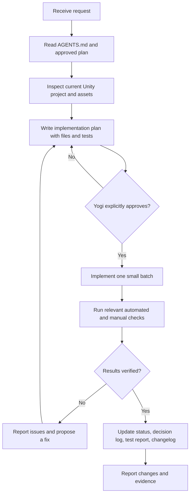

# GEMINI.md — AI Agent Work Rules for AlgeCard Adventure

> **Purpose:** This file is a concise index of the mandatory working rules for Gemini and other AI coding agents working on **AlgeCard Adventure**.
>
> **Project owner:** Yogi Ario.  
> **Core rule:** *No Plan, No Code. No Approval, No Code.*

Before performing project work, read the root [`AGENTS.md`](./AGENTS.md) and the approved project implementation plan. The expected documentation location is [`Docs/Implementation_plan.md`](./Docs/Implementation_plan.md), but verify that the file actually exists in the current workspace. If the plan or referenced document is missing, do not invent its contents; ask Yogi or locate the explicitly approved plan first.

## Mandatory Rules

1. **Implementation Plan and approval gate**  
   For every new feature, bug fix, structural change, or configuration change, inspect the current project and prepare a written implementation plan first. Include the goal, scope, options/trade-offs where relevant, target files, risks, test plan, and acceptance criteria. Wait for Yogi's explicit approval before editing code or project configuration. An instruction to inspect, analyze, or plan is not permission to implement.

2. **Project identity and technology**  
   - Project: **AlgeCard Adventure**, a 2D algebra-card educational adventure game.
   - Engine: Unity Universal 2D; current editor version is `6000.6.6f1` unless Yogi approves a change.
   - Language: C#.
   - Target: Android mobile, portrait UI.
   - Player-facing UI language: English.
   - MVP: single-player and offline.
   - Difficulty levels: **Easy, Normal, Hard**. Do not replace these with school-grade labels.

3. **Unity project safety**  
   Do not upgrade/downgrade Unity, change render pipeline/build settings, install/remove packages, or perform destructive operations without explicit approval. Do not delete, rename, move, overwrite, or mass-edit scenes, prefabs, scripts, assets, or Project Settings without documenting the impact and receiving approval.

4. **Offline-first; no unapproved services**  
   Do not add a backend, REST API, cloud database, login, analytics, ads, Groq/OpenRouter, Firebase, or any external service unless Yogi approves a separate plan. Use local game data and local session state for the MVP.

5. **UI and asset integrity**  
   Treat original UI mockups, logo source files, screenshots, and designer-provided reference assets as read-only. Never overwrite or remove source assets. Import or adapt copies into the appropriate Unity asset folders. Preserve the approved fantasy-adventure style, the green and orange cricket mascots, and the screen-by-screen approval process.

6. **Gameplay decisions that must remain consistent**  
   - Main flow: Splash Screen → Level Selection → Topic Selection → Mission Cards → Algebra Card Board → True or False → Explanation → Score Results.
   - Mission Cards: five face-down cards per batch; completed missions should not repeat in the same session.
   - Algebra Card Board: four sequential solving stages; internal identifiers `4a`–`4d` must not appear in player-facing UI. Keep Number Cards and Variable Cards accessible on the right or in a compact tray on narrow screens.
   - True/False: lock a submitted choice against double counting, show feedback for three seconds, then present the explanation. If the actual timer is not implemented, disclose that limitation.
   - Scoring: `score = (correct answers / questions answered) × 100`. Count each completed question once, retain cumulative session progress, and stop at 10 questions.
   - Canonical sample equation: `3x + 5 = 20` → `3x = 15` → `x = 5`. Ensure all statements and explanations are mathematically correct.
   - Do not change these decisions silently. Propose a change and wait for approval.

7. **Documentation-first workflow**  
   Keep project documentation current when relevant: `Docs/Task_Status.md`, `Docs/Decision_Log.md`, implementation plan, test report, and a timestamped changelog under `changelog/`. If a required document or directory does not exist, propose its creation in the plan first. Do not report documentation as updated unless it actually was.

8. **Testing and honest reporting**  
   Use Unity Test Framework tests where appropriate, plus relevant manual checks in the Editor and Android builds. Inspect Console errors and warnings related to the change. Never claim “100% PASS,” successful Android build, or a verified feature unless the corresponding test was actually run and its result observed. If a test cannot run, state why and list the remaining manual verification.

9. **Git and release safety**  
   Inspect the repository and current branch before Git operations. Do not commit or push directly to `main`; the owner controls merges to `main`. Use `develop` and feature branches when Git is configured and available. If Git or the expected remote is not configured, report the situation and request approval before initializing or pushing anything.

10. **Communication and session backup**  
    Work in small, reviewable batches. Explain the proposed file changes and wait for approval when required. If assumptions conflict with existing documentation, stop and ask rather than guessing. At the end of a meaningful work session, ask Yogi whether to save a Markdown chat summary under `Docs/chat/riwayat<ddmmyyyy>.md`.

## Standard Task Workflow

## Important Project Files

- [`AGENTS.md`](./AGENTS.md) — detailed mandatory agent rules.
- [`Docs/Implementation_plan.md`](./Docs/Implementation_plan.md) — approved implementation plan, if present at that path.
- [`Docs/Task_Status.md`](./Docs/Task_Status.md) — work progress, if present.
- [`Docs/Decision_Log.md`](./Docs/Decision_Log.md) — approved project decisions, if present.
- [`Docs/Test_Report.md`](./Docs/Test_Report.md) — verification evidence, if present.
- `Assets/Scenes/` — Unity scenes.
- `Assets/Scripts/` — C# source code.
- `Assets/Prefabs/` — reusable UI/game prefabs.
- `Assets/Art/` or the project's approved asset directory — game artwork and imported copies of references.
- `Assets/Tests/` — Unity tests, if configured.

> **Final rule:** Do not make code or project-setting changes until the written plan has been explicitly approved by Yogi. Never claim that a feature works without observed verification.
