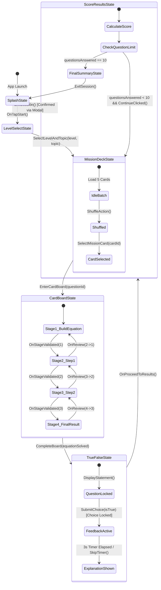

# AlgeCard Adventure — Backend & Game Logic Developer Specification

**Document Version:** 1.0  
**Target Platform:** Unity / C# Backend & Game Logic Service  
**Date:** Current Milestone Reference  
**Scope:** Architecture, Data Models, State Machines, APIs, and Validation Rules for *AlgeCard Adventure*.

---

## 1. Executive Summary & Purpose

This document provides complete technical specifications for the backend and game-logic engineers implementing **AlgeCard Adventure**. It formalizes the game rules, state transitions, mathematical validation pipeline, anti-cheat scoring rules, and data schemas demonstrated across the 6 approved UI prototype screens:

1. `01 Splash Screen`
2. `02 Level Selection`
3. `03 Mission Card Deck & Shuffling`
4. `04 Algebra Card Board (Step-by-Step Solver)`
5. `05 True or False & Explanation`
6. `06 Adventure Score Results & Session Finalization`

---

## 2. Session Lifecycle & State Machine

Every player session is strictly bounded by state transitions and a hard cap of **maximum 10 questions**.

### 2.1 State Diagram (Mermaid)



---

## 3. Data Models & Schemas

### 3.1 Difficulty & Topic Taxonomy

```typescript
export enum DifficultyLevel {
  EASY = "Easy",
  NORMAL = "Normal",
  HARD = "Hard"
}

export interface TopicDefinition {
  id: string;
  level: DifficultyLevel;
  name: string;
  description: string;
  minGrade: number;
}
```

#### Canonical Topics Matrix:
- **Easy:** `Variables & Simplification`, `Algebraic Substitution`, `One-Variable Linear Equations`
- **Normal:** `Multiplication of Algebraic Expressions`, `Factorization`, `Linear Equations with Variables on Both Sides`
- **Hard:** `Systems of Linear Equations in Two Variables`, `Inequalities`, `Exponents & Quadratic Factorization`

---

### 3.2 Question & Mission Model

```typescript
export interface CardSlot {
  slotId: string;
  expectedType: "NUMBER" | "VARIABLE" | "OPERATOR";
  expectedValue: string; // e.g., "3", "x", "+", "5", "20"
  isFixed: boolean;      // Operators like '=', '+' can be fixed or placeable
}

export interface BoardStage {
  stageIndex: 1 | 2 | 3 | 4;
  instructionText: string;
  expressionDisplay: string;
  slots: CardSlot[];
  availableCardIds: string[];
}

export interface TrueFalseStatement {
  statementText: string;        // "If x = 2, then the value of 3x + 4 = 10"
  canonicalVariableVal: number; // 2
  correctAnswer: boolean;       // true
  stepByStepExplanation: string[];
  tips: string;
}

export interface MissionQuestion {
  questionId: string;
  topicId: string;
  level: DifficultyLevel;
  problemStatement: string;     // e.g., "If 3x + 5 = 20, find the value of x."
  stages: BoardStage[];
  trueFalsePhase: TrueFalseStatement;
}
```

---

### 3.3 Session & Player State

```typescript
export interface PlayerSessionState {
  sessionId: string;
  selectedLevel: DifficultyLevel;
  selectedTopicId: string;
  
  // Scoring & Metrics
  questionsAnswered: number;      // Max 10
  correctAnswers: number;
  wrongAnswers: number;
  cumulativeScore: number;       // Integer 0-100 (Math.round((correct / answered) * 100))
  sessionStartTime: number;      // Epoch ms
  totalElapsedTimeSeconds: number;
  
  // Anti-Cheat & Flow
  completedQuestionIds: string[]; // Avoid duplicates within session
  currentQuestionId: string | null;
  currentStageIndex: number;      // 1..4
  hasAnsweredCurrentTF: boolean;  // Lock to avoid double scoring
  isSessionFinished: boolean;     // True when questionsAnswered >= 10
}
```

---

## 4. Scoring Engine & Rules

### 4.1 Cumulative Scoring Formula
The scoring formula **must not** reset per question. It tracks the entire session cumulative accuracy:

$$\text{Score} = \text{round}\left( \frac{\text{Correct Answers}}{\text{Questions Answered}} \times 100 \right)$$

#### Constraints & Edge Cases:
1. **Zero State:** If `questionsAnswered == 0`, score displays `0` or `—` (do not divide by zero).
2. **Answer Locking:** Once `SubmitChoice(isTrue)` is called in `Screen 05`:
   - Set `hasAnsweredCurrentTF = true`.
   - Any repeated RPC/call for the same `questionId` **must return HTTP 409 / Conflict** to eliminate double submissions.
3. **Card Board Stages:** Completing Stages 1, 2, 3, or 4 does **NOT** increment `questionsAnswered`. A question is only counted after the True/False choice is submitted.
4. **Incorrect Choice:** If the player chooses incorrectly:
   - `questionsAnswered` increments by `1`.
   - `wrongAnswers` increments by `1`.
   - `correctAnswers` remains unchanged.
5. **Score Rounding:** All user-facing APIs return an integer (`Math.round`), but internal records may store double-precision floats (`66.67`).

---

## 5. Mathematical Validation Engine (Algebra Board)

For Screen 04, card movements from the Deck to Board slots must undergo rigorous server-side / engine-level validation:

### 5.1 Canonical Canonical Example Validation Table (`3x + 5 = 20`)

| Stage | Operation Step | Target Linear State | Required Slot Values |
|---|---|---|---|
| **Stage 1** | Initial Equation Formation | $3x + 5 = 20$ | `['3', 'x', '+', '5', '=', '20']` |
| **Stage 2** | Isolate Variable Term | $3x = 20 - 5$ | `['3', 'x', '=', '20', '-', '5']` |
| **Stage 3** | Divide Both Sides | $x = \frac{15}{3}$ or $3x = 15 \rightarrow x = 15 / 3$ | `['x', '=', '15', '/', '3']` |
| **Stage 4** | Final Root Result | $x = 5$ | `['x', '=', '5']` |

### 5.2 Server Validation Algorithm (Pseudo-Code)

```csharp
public ValidationResult ValidateStagePlacement(string questionId, int stageIndex, List<SlotAssignment> assignments)
{
    var question = QuestionRepository.Get(questionId);
    var targetStage = question.Stages.FirstOrDefault(s => s.StageIndex == stageIndex);
    
    if (targetStage == null) 
        return ValidationResult.Fail("Stage not found");

    foreach (var slot in targetStage.Slots)
    {
        var placedCard = assignments.FirstOrDefault(a => a.SlotId == slot.SlotId);
        if (placedCard == null)
            return ValidationResult.Fail($"Slot {slot.SlotId} is empty");
            
        if (placedCard.CardValue != slot.ExpectedValue)
            return ValidationResult.Fail($"Card mismatch at {slot.SlotId}: Expected {slot.ExpectedValue}, Got {placedCard.CardValue}");
    }

    return ValidationResult.Success();
}
```

---

## 6. Shuffling & Card Deck Randomization

### 6.1 Requirements
1. A batch presents **exactly 5 face-down cards**.
2. Cards drawn must belong to the selected `topicId` and `level`.
3. **No Repetition:** Any `questionId` in `completedQuestionIds` must be excluded from subsequent draws in that session.
4. **Exhaustion Fallback:** If the question pool in the selected topic has fewer than 5 unplayed questions left when a new batch is requested:
   - Serve the remaining pool questions.
   - If completely exhausted before 10 questions, gracefully fallback to closely related topics within the same `DifficultyLevel` or emit a `PoolExhausted` event.

---

## 7. Recommended Client-Server REST / WebSocket API Endpoints

### `POST /api/v1/session/start`
- **Request:** `{ "level": "Easy", "topicId": "topic_vars_01" }`
- **Response:**
  ```json
  {
    "sessionId": "sess_88291a9b",
    "level": "Easy",
    "topicId": "topic_vars_01",
    "maxQuestions": 10,
    "currentQuestionIndex": 0,
    "startTime": 1776384000
  }
  ```

### `POST /api/v1/session/batch/draw`
- **Request:** `{ "sessionId": "sess_88291a9b" }`
- **Response:**
  ```json
  {
    "batchSize": 5,
    "cards": [
      { "cardSlotIndex": 1, "cardId": "c_01", "isRevealed": false },
      { "cardSlotIndex": 2, "cardId": "c_02", "isRevealed": false },
      { "cardSlotIndex": 3, "cardId": "c_03", "isRevealed": false },
      { "cardSlotIndex": 4, "cardId": "c_04", "isRevealed": false },
      { "cardSlotIndex": 5, "cardId": "c_05", "isRevealed": false }
    ]
  }
  ```

### `POST /api/v1/session/question/reveal`
- **Request:** `{ "sessionId": "sess_88291a9b", "chosenCardIndex": 3 }`
- **Response:** Returns the question payload (`MissionQuestion`), initializing the Algebra Card Board.

### `POST /api/v1/session/question/tf-submit`
- **Request:** 
  ```json
  {
    "sessionId": "sess_88291a9b",
    "questionId": "q_algebra_canonical_3x5",
    "userAnswer": true
  }
  ```
- **Response:**
  ```json
  {
    "isCorrect": true,
    "questionsAnswered": 5,
    "correctAnswers": 4,
    "wrongAnswers": 1,
    "cumulativeScore": 80,
    "explanation": {
      "steps": [
        "Substitute x = 2 into 3x + 4",
        "3(2) + 4 = 6 + 4",
        "6 + 4 = 10"
      ],
      "resultText": "3x + 4 = 10",
      "conclusion": "TRUE"
    },
    "canContinue": true,
    "isSessionFinished": false
  }
  ```

### `POST /api/v1/session/terminate`
- Cleans up in-memory session caches, records analytics, and persists high scores.

---

## 8. Unity Client Implementation Notes

1. **Timer Precision:** The 3-second feedback timer in Screen 05 should use a non-blocking `UniTask.Delay(3000, cancellationToken)` or coroutine with a skip trigger if the user taps "Skip countdown".
2. **Audio Triggers:** Emit audio events:
   - `Sfx_CardShuffle` on Mission Deck Shuffle
   - `Sfx_CardSnap` on board slot snapping
   - `Sfx_CorrectFanfare` on True/False correct choice
   - `Sfx_ErrorBuzzer` on incorrect choice
   - `Sfx_VictoryChime` on Screen 06 Score Results display
3. **Asset Binding:** Bind the approved `logo.png` image directly to the UI canvas atlas for seamless rendering without runtime scaling artifacts.
