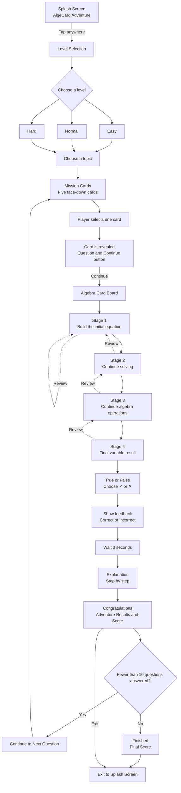
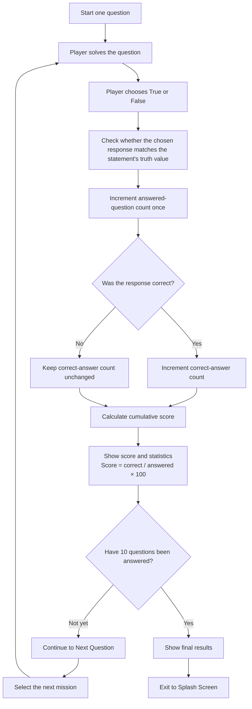

# Implementation Plan — AlgeCard Adventure (Google Stitch)

**Version:** 1.1  
**Date:** 17 October 2026  
**Document purpose:** The main reference for creating an interactive mobile UI prototype in Google Stitch before implementing the actual game in Unity.

> **Language requirement:** Both this implementation plan and all player-facing game UI must be in English for the international competition. Translate every title, instruction, topic, card label, button, feedback message, and explanation consistently.

---

## 1. Project Overview

Create a portrait mobile UI prototype for **AlgeCard Adventure**, an educational mathematics game for junior high school students. The game uses algebra cards, missions, step-by-step equation solving, True/False statements, explanations, and a cumulative score system.

The prototype must demonstrate a consistent flow between screens. It is **not** a complete implementation of the game and must not claim that randomization, mathematical validation, progress persistence, or time tracking truly works unless that interaction has actually been implemented and tested in Stitch.

## 2. Prototype Objectives

1. Demonstrate the flow from the Splash Screen to the score results.
2. Test portrait UI readability and the main interactions.
3. Show five face-down mission cards, the selected/revealed mission card, the algebra-solving board, feedback, and explanations.
4. Explain the cumulative scoring mechanism for a maximum of 10 questions.
5. Keep the visual style consistent with the AlgeCard Adventure reference illustrations.
6. Provide a prototype and design assets that can later guide implementation in Unity.

## 3. Platform and Design Rules

- **Target platform:** Android mobile UI.
- **Orientation:** Portrait.
- **UI language:** English throughout the prototype.
- **Visual style:** Educational fantasy adventure, including forests, castles, adventure paths, wooden boards, leaves, mathematics books, a compass, and two cricket mascots—one green and one orange.
- **Logo:** “AlgeCard Adventure”. Use the same spelling on every screen.
- **Usability:** High contrast, large buttons, readable text, and touch targets suitable for junior high school students.
- **Consistency:** Use a consistent color palette, typography, card shapes, icons, mascots, and button components. Always label the selection category “Level,” with exactly three options: “Easy,” “Normal,” and “Hard.” Do not use “Grade,” “Class,” or numbered school grades in the selection UI.
- **References:** Use the supplied screen images as visual references, not as substitutes for interactions that need to be prototyped.
- **No extra features:** Do not add login, multiplayer, a backend/server, teacher dashboard, shop, advertisements, or features not specified in this document.

### UI Recommendations

- Reuse components for primary buttons, back buttons, title panels, mission cards, number-card decks, variable-card decks, feedback panels, and score statistics.
- Keep the main content large enough to read. If the right-side card deck reduces the play area on a phone screen, use a compact layout: give the board the largest area and keep the right-side deck accessible in a compact tray/panel. Do not shrink every component just to preserve a desktop-style layout.
- Use one mathematically correct and consistent sample problem throughout the prototype.

## 4. Scope

### In Scope

- Six main screen groups.
- Example difficulty levels and topic lists.
- Five face-down mission cards per batch and selected/revealed card states.
- Four stages of the algebra-card board.
- Number-card and variable-card decks on the right side of the board screen.
- “Continue” and “Review” buttons.
- True/False choices, 3-second feedback, explanation, and score results.
- Cumulative scoring and a maximum of 10 questions as prototype rules.
- “Continue to Next Question” and “Exit” buttons.

### Out of Scope

- Login and user profiles.
- Multiplayer or online play.
- Cloud/server synchronization.
- Teacher dashboard.
- Monetization, advertisements, or in-app purchases.
- Administrator content management.
- Production implementation in Unity, persistent storage, or a real mathematical validation engine.

## 5. Screen Structure

The term “six main screens” refers to six activity groups. Some groups contain multiple UI states.

### Screen 1 — Splash Screen

**Content:** AlgeCard Adventure logo and adventure illustration.  
**Interaction:** Show the text **“Tap anywhere to start”**. Tapping opens Level Selection.  
**Exit behavior:** The “Exit” button on the results screen returns to the initial/Splash Screen, according to the selected design.

### Screen 2 — Level and Topic Selection

The screen must use **Level** as the selection category—not school grades or class numbers.

**Difficulty levels:**
- **Easy** — introductory algebra topics.
- **Normal** — intermediate algebra topics.
- **Hard** — more challenging algebra topics.

After a level is selected, show the relevant topic options.

**Temporary sample topics:**
- **Easy:** Variables & Simplification; Algebraic Substitution; One-Variable Linear Equations.
- **Normal:** Multiplication of Algebraic Expressions; Factorization; Linear Equations with Variables on Both Sides.
- **Hard:** Systems of Linear Equations in Two Variables; Inequalities; Exponents; Quadratic Factorization.

These level/topic mappings are temporary prototype content and can be reviewed before production. The selected level and topic are passed to the Mission Cards screen and used to select suitable questions.

### Screen 3 — Mission Cards

**Initial state:**
- Show the title “Mission Cards” and the selected level and topic.
- Display exactly five face-down cards with a consistent card back.
- Show the instruction “Choose one mission card”.

**After a card is selected:**
- Reveal only the selected card and show its question/mission.
- Show a short problem description and the **“Continue”** button.
- The “Continue” button opens the Algebra Card Board and passes along the same selected question.
- Do not reveal the complete answer or explanation during mission selection.

**Randomization and repetition:**
- For the prototype, simulate shuffling five missions from the available question pool.
- A completed question must not appear again in the same batch.
- After all five missions have been completed, if fewer than 10 questions have been answered, prepare a new batch from unused questions or display a message that the sample question pool is exhausted.
- Do not claim that true randomization is implemented if the prototype only contains a visual transition.

### Screen 4 — Algebra Card Board

Show the question from the selected mission card at the very top. The play area must present four solving stages. **Labels 4a, 4b, 4c, and 4d are documentation-only labels and must not appear in the final UI.**

#### Stage 1 — Board for Building the Equation

Instruction text: **“Use number and variable cards to build the equation correctly.”**

- Show the initial equation/slots that the player must build.
- Place the **Number Cards** and **Variable Cards** decks to the right of the board.
- Simulate moving cards from the decks to the board slots using drag-and-drop interaction.
- Operators may be fixed parts of the equation template/slots if they are not supplied as separate cards.

#### Stage 2 — Board for Solving the Equation

- Show the result of the previous stage as context.
- Provide continuation slots for the appropriate operation.
- Keep the number and variable card decks on the right.
- The player places cards to build the next solution line.

#### Stage 3 — Continue Solving

- Show the equation transformation from the previous step.
- The player arranges the next operation until the variable can be determined.
- Preserve previously valid cards/results when the player presses “Review” to return to the previous stage.

#### Stage 4 — Final Card Arrangement

- Show the completed arrangement with the variable solved.
- Display the final answer clearly.
- Include the **“Continue”** and **“Review”** buttons.

**Button behavior:**
- **Continue:** validate/confirm the current stage and proceed to the next stage. After the final result is confirmed, go to Screen 5.
- **Review:** return one stage so the player can correct the arrangement. Preserve valid work where appropriate.
- Do not count each stage as a separate question. One completed mission counts as one question.

**Canonical sample problem for the prototype:**

`3x + 5 = 20`

Correct steps:
1. Initial equation: `3x + 5 = 20`
2. Subtract 5 from both sides: `3x = 15`
3. Divide both sides by 3: `x = 5`
4. Final result: `x = 5`

Use the example consistently in the demonstration mission. Ensure every symbol, number, step, True/False statement, and explanation is mathematically consistent.

### Screen 5 — True or False and Explanation

This screen group has three states.

**State A — Statement:**
- Display a statement related to the selected mission and the result just obtained.
- Provide two large buttons: **“✓ True”** and **“✕ False”**.
- The statement must have a clearly defined truth value based on the mathematical solution.

**State B — Feedback:**
- After the player makes a choice, lock the choice so it cannot be counted twice.
- If the choice is correct, show positive feedback and a ✓ symbol.
- If the choice is incorrect, show friendly corrective feedback and a ✕ symbol.
- Show feedback for **3 seconds**, then automatically open the explanation.
- If Stitch cannot support an automatic timer in the prototype, simulate the transition with a prototype action/button and document that the actual timer has not been implemented.

**State C — Explanation:**
- Show the question/statement, solution steps, and the correct conclusion.
- Include a button to continue to the score results.
- Explain the mathematical reasoning instead of displaying only “correct” or “incorrect.”

**Consistent sample statement:** “If `x = 5`, then `3x + 5 = 20`.” The correct response is **True** because `3(5) + 5 = 15 + 5 = 20`.

### Screen 6 — Congratulations / Adventure Results

Display:
- The titles “Congratulations” and “Adventure Results”.
- Cumulative score, for example `80 out of 100`.
- Number of correct answers.
- Number of incorrect answers.
- Elapsed time as sample UI content.
- An encouraging message: “Great job! Keep practicing to become even better!”
- **“Continue to Next Question”** and **“Exit”** buttons.

**Continue to Next Question:**
- If fewer than 10 questions have been answered, return to Mission Cards so the player can choose the next question.
- Preserve the score, correct-answer count, incorrect-answer count, total elapsed time, and list of already completed questions in the same session.
- After 10 questions have been answered, replace the button with **“View Final Results”** or **“Finish”** and do not create an eleventh question.

**Exit:** return to the Splash Screen. If the prototype adds an exit confirmation dialog, the dialog must provide options to cancel or confirm exiting.

## 6. Scoring Rules

Use cumulative scoring rather than resetting the score for each question.

`Score = (number of correct answers / number of questions answered) × 100`

Rules:
- Each mission that reaches the True/False choice and explanation counts as one answered question.
- An incorrect answer still increases the number of questions answered but does not increase the correct-answer count.
- The True/False choice for one question can only be recorded once.
- The algebra-board stages do not count as separate questions.
- If no question has been answered, do not show a final score; show an initial state or `—`.
- Display rounding: use a whole-number score in the main UI; if a fractional score is shown, use at most two decimal places.
- Maximum: 10 questions per session.

| Questions answered | Correct answers | Score |
|---:|---:|---:|
| 1 | 0 | 0 |
| 1 | 1 | 100 |
| 2 | 1 | 50 |
| 3 | 2 | 66.67 |
| 4 | 3 | 75 |
| 5 | 4 | 80 |
| 10 | 10 | 100 |

Use these examples consistently in the results UI. Scores shown in illustrations are examples only, not actual results from a running game.

## 7. Main Flow Diagram (Mermaid)

## 8. Scoring Logic Diagram (Mermaid)

## 9. Stitch Prototype Interaction Guide

- All primary buttons must connect to the appropriate screen/state.
- Splash Screen: tapping the screen opens level selection.
- Level selection: choosing Easy, Normal, or Hard shows the relevant topics.
- Topic selection: choosing a topic opens Mission Cards.
- Mission Cards: show five face-down cards; selecting one reveals the question; “Continue” opens the card board.
- Card Board: card movement must be visually represented; “Continue” and “Review” change the active stage.
- True/False: a choice triggers the corresponding feedback state, followed by the explanation state.
- Explanation: the continue button opens the score results screen.
- Results: “Continue to Next Question” returns to the next mission batch if fewer than 10 questions have been answered; “Exit” returns to the Splash Screen.
- Show active, selected, correct/incorrect, and pressed button states where the prototype supports them.
- If Stitch does not support actual behavior (such as drag-and-drop, automatic timers, randomization, or cross-screen score persistence), use a plausible interaction simulation and document the limitation. Do not describe a simulated feature as production-ready functionality.

## 10. Acceptance Criteria

The prototype is ready for review when:

- [ ] All screen groups are present and the visual style is consistent.
- [ ] All player-facing UI text—including screen titles, topic names, instructions, buttons, feedback, and explanations—is in English.
- [ ] The Splash Screen contains the tap-to-start instruction.
- [ ] Easy/Normal/Hard level and topic selection are connected.
- [ ] Mission Cards show exactly five face-down cards and a selected/revealed state.
- [ ] The selected mission question remains the same when entering the card board.
- [ ] The card board shows four solving stages in sequence.
- [ ] Number and variable decks appear on the right or in a compact tray on narrow screens.
- [ ] Internal labels 4a/4b/4c/4d do not appear in the final UI.
- [ ] “Review” goes to the previous stage and “Continue” goes to the next stage.
- [ ] The True/False statement is consistent with the mathematical solution.
- [ ] Three-second feedback and the explanation state are visible in the prototype, or the timer limitation is documented.
- [ ] Cumulative scoring follows the correct formula and each question is counted only once.
- [ ] “Continue to Next Question” preserves progress and respects the 10-question limit.
- [ ] After 10 questions, the player cannot start an eleventh question from the continue button.
- [ ] “Exit” returns to the Splash Screen.
- [ ] All buttons can be tested without dead ends.

## 11. Implementation Priorities in Stitch

### P0 — Required

- Build screen groups 1–6.
- Connect the main flow.
- Use one mathematically correct and consistent sample question.
- Build mission-card, card-board, True/False, explanation, and results states.
- Apply cumulative-score rules in the prototype as far as the tool supports.

### P1 — After P0 Works

- Card-flip animation, selected-card highlight, correct/incorrect feedback, and transitions.
- Better responsiveness for small mobile screens.
- Question progress indicator (for example, “Question 3 of 10”).
- Empty state or message when the mission pool is exhausted.

### Deferred

- Login, multiplayer, online leaderboard, server, teacher dashboard, complex settings, and premium features.

## 12. Prompt for Google Stitch

Use the following text with the UI reference images and this document:

> Build an interactive portrait mobile UI prototype for AlgeCard Adventure based on this Implementation Plan and the attached reference images. Maintain the fantasy-adventure visual style with forests, castles, wooden panels, algebra cards, and green/orange cricket mascots. Create six main screen groups and their derived states, and connect every button to the correct flow.
>
> Prioritize this sequence: Splash Screen → Level Selection (Easy/Normal/Hard) → Topic Selection → Mission Cards (five face-down cards) → Algebra Card Board (four stages, with number and variable decks on the right) → True or False → 3-second feedback → Explanation → Congratulations/Adventure Results → Continue to Next Question until a maximum of 10 questions, or Exit to the Splash Screen.
>
> Use a consistent example: `3x + 5 = 20`, then `3x = 15`, then `x = 5`. Example statement: “If x = 5, then 3x + 5 = 20.” The correct response is True because `3(5) + 5 = 20`.
>
> Cumulative score = correct answers / questions answered × 100. Count each mission only once; an incorrect answer still increases the number of questions answered. The maximum is 10 questions. “Continue to Next Question” must continue the same session without clearing the score or repeating completed missions. After 10 questions, show final results and do not open an eleventh question.
>
> Do not show the documentation labels 4a, 4b, 4c, or 4d in the final UI. Use English, consistent components, large touch-friendly buttons, and clear navigation. If actual behavior such as randomization, drag-and-drop, timers, mathematical validation, or progress persistence cannot be implemented in the prototype, show a reasonable simulation and document the limitation. Do not add out-of-scope features.

## 13. Notes for Implementation After Stitch

The Stitch prototype is a design/flow-validation artifact. Before releasing an actual game, implement and test the following in Unity:

- Mission randomization and duplicate prevention.
- Equation and mathematical-step validation.
- State management for the card-board stages.
- Drag-and-drop/tap input on Android.
- A real 3-second feedback timer.
- Score and session-progress persistence.
- A maximum of 10 questions.
- Testing across Android screen aspect ratios, accessibility, and error handling.

---

**Primary basis:** The user's supplied `Prompt.md` and the flow decisions confirmed during the discussion. This document is a plan for a Stitch UI prototype; it does not claim that the Unity game has already been implemented.

## 14. Screen-by-Screen Production and Approval Workflow

This section adds a controlled workflow for creating and reviewing the six screen images in Google Stitch. **All sections above remain unchanged.** Use the screen filenames exactly as listed below. Work on one screen at a time; do not begin the next screen until the current screen has been reviewed and explicitly approved by the user.

### Required Working Rule

1. Start with `01 Splash Screen.png`.
2. The user uploads the current screen image from Stitch.
3. Review only that screen against this implementation plan and its screen-specific checklist below.
4. Report specific mismatches and actionable corrections. Do not redesign unrelated screens or change previously approved decisions.
5. The user revises the screen in Stitch and uploads the updated image when ready.
6. Repeat review until the user confirms that the screen is correct.
7. Only after explicit approval, proceed to the next numbered screen.
8. Continue in filename order from `01` through `06`. Do not skip ahead, review several screens as a batch, or assume approval from silence.

The user is the final approver of each screen. A screen is considered approved only when the user explicitly says it is approved or that it is correct and ready to continue.

### Screen 01 — Splash Screen

**Reference filename:** `01 Splash Screen.png`

Review checklist:
- The “AlgeCard Adventure” logo is spelled consistently.
- The portrait composition matches the approved fantasy-adventure visual style.
- The screen displays the exact instruction **“Tap anywhere to start”**.
- Tapping/clicking the screen in the prototype leads to Screen 02 — Level Selection.
- All player-facing text is in English.
- The logo, main illustration, and instruction are readable and not unintentionally clipped.

**Approval gate:** Do not request or start work on Screen 02 until Screen 01 is approved.

### Screen 02 — Level

**Reference filename:** `02 Level.png`

Review checklist:
- The selection heading uses **“Level”**, not “Grade” or “Class”.
- Exactly three choices are shown: **Easy**, **Normal**, and **Hard**.
- Selecting a level reveals the appropriate topic list.
- Topic examples match Section 5 of this plan and are written in English.
- Selecting a topic leads to Screen 03 — Mission Cards.
- Layout, touch targets, and text are readable on a portrait mobile screen.

**Approval gate:** Do not request or start work on Screen 03 until Screen 02 is approved.

### Screen 03 — Mission Card

**Reference filename:** `03 Mission Card.png`

Review checklist:
- The initial state displays exactly five face-down mission cards.
- The instruction tells the player to choose one mission card.
- Selecting one card reveals only the selected card and its question.
- The revealed state includes a **“Continue”** button.
- The question passed to the next screen is the same question revealed on the card.
- The answer and explanation are not revealed prematurely.
- The visual state makes the difference between face-down and revealed cards clear.

**Approval gate:** Do not request or start work on Screen 04 until Screen 03 is approved.

### Screen 04 — Algebra Card Board

**Reference filename:** `04 Algebra Card Board.png`

Review checklist:
- The selected mission question appears at the top of the screen.
- The board contains four sequential solving stages: building the initial equation, solving step 1, continuing the algebra operations, and showing the final variable result.
- Do not show the internal labels `4a`, `4b`, `4c`, or `4d` as visible UI headings.
- The Number Cards and Variable Cards decks are on the right when screen width permits; use a compact accessible tray on narrow portrait screens.
- Card movement from the deck to the equation slots is visually understandable.
- The canonical sample problem remains mathematically consistent: `3x + 5 = 20` → `3x = 15` → `x = 5`.
- **“Continue”** proceeds to the next stage or validates the final stage; **“Review”** returns to the previous stage.
- Intermediate stages do not count as separate questions.

**Approval gate:** Do not request or start work on Screen 05 until Screen 04 is approved.

### Screen 05 — True or False

**Reference filename:** `05 True or False.png`

Review checklist:
- The screen shows a mathematically valid statement based on the selected mission and completed solution.
- The answer choices are labelled **“True”** and **“False”**, with clear checkmark and cross icons.
- After a choice, the corresponding correct/incorrect feedback state appears and prevents a second answer from being counted.
- Feedback indicates a three-second delay before the explanation appears. If Stitch cannot implement a real timer, document and simulate the transition instead.
- The explanation contains clear step-by-step reasoning and a correct conclusion.
- The Continue action leads to Screen 06 — Score Results.
- All visible text is in English.

**Approval gate:** Do not request or start work on Screen 06 until Screen 05 is approved.

### Screen 06 — Score Results

**Reference filename:** `06 Score Results.png`

Review checklist:
- The screen shows **“Congratulations”** and **“Adventure Results”**.
- It presents the cumulative score, correct-answer count, incorrect-answer count, and elapsed time.
- Score examples follow `correct answers / questions answered × 100`.
- **“Continue to Next Question”** returns to Screen 03 and preserves the current session's score and progress when fewer than ten questions have been answered.
- Previously completed questions should not be repeated in the same session.
- After ten questions, the continue action is replaced with **“View Final Results”** or **“Finish”**.
- **“Exit”** returns to Screen 01 — Splash Screen.
- All visible text is in English and every primary button has a clear destination.

**Approval gate:** Screen 06 completes the six-screen UI review cycle only after the user approves it.

### Review Response Format

For every uploaded screen image, provide feedback in this structure:

1. **Status:** Approved, or Needs Revision.
2. **What matches the plan:** list only confirmed matches.
3. **Required corrections:** list precise mismatches, if any; do not invent issues.
4. **Next action:** if approved, invite the user to upload the next numbered screen. If not approved, ask for the revised image of the current screen only.

Do not proceed to another screen based on an assumption. Wait for the user's explicit approval.

### Screen Production Tracker

Update this tracker as screens are reviewed. Mark a screen as approved only after explicit user confirmation.

| Order | Required filename | Status |
|---:|---|---|
| 01 | `01 Splash Screen.png` | Not started |
| 02 | `02 Level.png` | Blocked until 01 is approved |
| 03 | `03 Mission Card.png` | Blocked until 02 is approved |
| 04 | `04 Algebra Card Board.png` | Blocked until 03 is approved |
| 05 | `05 True or False.png` | Blocked until 04 is approved |
| 06 | `06 Score Results.png` | Blocked until 05 is approved |

---

**Change note — Version 1.2:** Added only this screen-by-screen production and approval workflow. The original Implementation Plan content above was preserved unchanged.
