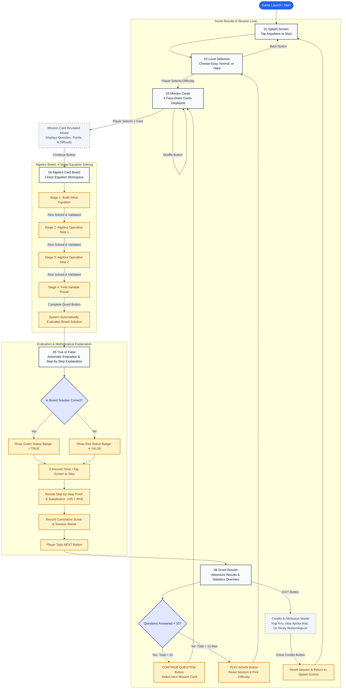

<p align="center">
  
</p>

<h1 align="center">AlgeCard Adventure</h1>

<p align="center">
  <strong>Game Edukasi Matematika Berbasis Kartu Aljabar untuk Siswa Sekolah Menengah</strong>
</p>

<p align="center">
  <a href="https://github.com/useripx/algecardadventure"></a>
  
  
  
  
  
  
  
</p>

---

## 📖 Tentang Proyek

**AlgeCard Adventure** adalah permainan edukasi matematika 2D portrait untuk perangkat Android. Menggabungkan konsep petualangan fantasi kartun cerah, panel kayu/perkamen, kartu angka dan variabel, serta maskot jangkrik hijau dan oranye untuk membantu siswa memahami persamaan linear aljabar langkah-demi-langkah.

Game ini dirancang murni **offline, single-player**, mandiri tanpa ketergantungan server/cloud, dengan seluruh teks antarmuka (*in-game UI*) berbahasa Inggris untuk standar kompetisi internasional.

---

## 🎮 Alur Permainan (Official Game Flowchart)

Dokumentasi rancang bangun sistem dan spesifikasi edukasi lengkap tersedia di **[Docs/Game_Description.md](Docs/Game_Description.md)**.



1. **01 Splash Screen:** Layar pembuka dengan logo resmi dan interaksi *“Tap anywhere to start”*.
2. **02 Level Selection:** Pilihan tingkat kesulitan (`Easy`, `Normal`, `Hard`).
3. **03 Mission Cards:** Batch berisi 5 kartu misi tertutup yang diacak dari bank soal eligible. Pemain memilih 1 kartu.
4. **04 Algebra Card Board:** Papan kerja penyelesaian persamaan bertahap (4 tahap: Membangun persamaan, operasi langkah 1, operasi langkah 2, dan hasil akhir variabel). Tersedia dek kartu angka (0-9), variabel (x, y, a, b), operator (+, -, ×, ÷, =), tombol 3D Clear, dan navigasi D-Pad.
5. **05 True or False:** Evaluasi otomatis kebenaran pengerjaan papan aljabar, status badge √ TRUE / ✕ FALSE, timer feedback 3 detik, penjelasan pembuktian substitusi, dan tombol `NEXT ❯` menuju hasil nilai.
6. **06 Score Results:** Ringkasan hasil petualangan, persentase skor kumulatif, kartu performa, navigasi lanjut misi (soal < 10), main ulang (soal = 10), dan tombol Exit dengan modal Credits resmi.

---

## 🛠️ Spesifikasi Teknologi

- **Engine:** Unity `6000.6.6f1` (Universal 2D)
- **Render Pipeline:** Universal Render Pipeline (URP 17.6.0)
- **Bahasa Pemrograman:** C# (.NET Standard 2.1)
- **UI Framework:** Unity UI (uGUI 2.6.0) & TextMeshPro
- **Testing Framework:** Unity Test Framework (UTF 1.8.0 - EditMode & PlayMode)
- **Target Platform:** Android Mobile (Portrait Orientation)
- **Sumber Data:** Lokal `Assets/StreamingAssets/banksoal.json` (60 Soal: 20 Easy, 20 Normal, 20 Hard)

---

## 🏛️ Tata Kelola & Standar Kerja (Universal Governance)

Proyek ini mematuhi **8 Pilar Standar Kerja Universal**:

- **Pilar 1 (ZERO-CODE Approval Gate):** Tidak ada perubahan kode atau konfigurasi tanpa rencana tertulis yang disetujui pemilik proyek.
- **Pilar 2 (Git Branching Strategy):** Branch `main` adalah produksi tertutup (hanya di-merge oleh Yogi Ario). Seluruh integrasi dikerjakan di branch `develop` atau `feature/*`.
- **Pilar 3 (Zero Secret Leakage):** Dilindungi `.gitignore` standar sejak hari pertama.
- **Pilar 4 (Asset Protection):** Folder [Docs/Ui Template/](Docs/Ui%20Template) berstatus **READ-ONLY**.
- **Pilar 5 (Documentation-First):** Dilengkapi [Task Status](Docs/Task_Status.md), [Decision Log](Docs/Decision_Log.md), dan [Changelog](changelog/).
- **Pilar 6 (100% Automated Testing Gate):** Seluruh logika inti diverifikasi dengan Unit Test otomatis sebelum rilis batch.
- **Pilar 7 (Lean & Resilient):** Game berjalan 100% offline tanpa ketergantungan pihak ketiga.
- **Pilar 8 (Proactive & Consultative):** Komunikasi transparan berbasis opsi dan pencadangan riwayat sesi secara berkala.

---

## 🚀 Panduan Memulai (Development Setup)

1. Pastikan **Unity Hub** dan Unity Editor versi **`6000.6.6f1`** dengan modul **Android Build Support** terpasang.
2. Clone repositori:
   ```bash
   git clone https://github.com/useripx/algecardadventure.git
   cd algecardadventure
   git checkout develop
   ```
3. Buka proyek melalui Unity Hub.
4. Jalankan pengujian otomatis melalui menu Unity:
   `Window` → `General` → `Test Runner` → pilih tab `EditMode` → klik `Run All`.

---

## 👤 Pemilik Proyek & Lisensi

- **Project Owner & Lead Developer:** Yogi Ario
- **Hak Cipta:** &copy; 2026 AlgeCard Adventure. Seluruh hak cipta dilindungi.
